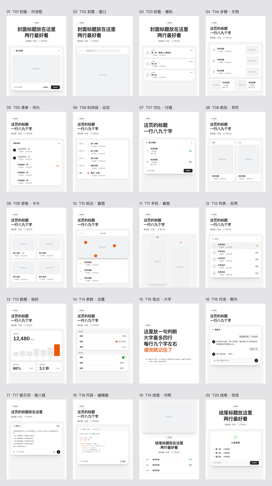
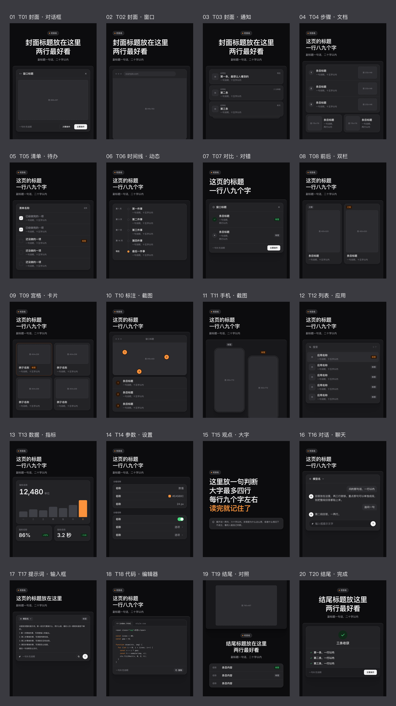

# Ian XHS Carousel

[中文](README.md) | **English**

> Turn articles, case studies or notes into a 3:4 Xiaohongshu (RedNote) carousel.
>
> 1080×1440 portrait | 20 templates | Light / Dark | Claude Code Skill

---

## What is this

Ian XHS Carousel is an AI skill that turns your content into a Xiaohongshu carousel in a clean product-UI style.

Hand it your content and it first gives you a storyboard to approve. Once you approve, it lays out the pages and renders the images.

**Works best with Claude.**

---

## Who it's for

- People who write articles or case studies and want a Xiaohongshu carousel to go with them
- Creators covering AI, products, design or productivity tools, with lots of screenshots, steps, comparisons, numbers or code
- Anyone who wants every post to look consistent and clean

If you're after hand-drawn, illustrated or bold poster styles, this isn't the right fit.

The skill and its templates are in Chinese, and the output is designed for Chinese posts.

---

## What you get

- **Storyboard**: what each page says, which template it uses and the headline, for you to approve first
- **One PNG per page**: 1080×1440, ready to post
- **Overview image**: all pages side by side, so you can see the flow at a glance
- **HTML source**: edit text or swap images yourself, then re-render

Light and dark themes are both available with the same layout.

The post title, caption and hashtags are up to you.

---

## The 20 templates



<details>
<summary>Dark</summary>



</details>

| Group | Templates |
|---|---|
| Cover | T01 Dialog, T02 Window, T03 Notifications |
| How-to | T04 Steps, T05 Checklist, T06 Timeline |
| Compare | T07 Right vs. wrong, T08 Before / after |
| Showcase | T09 Grid, T10 Annotated screenshot, T11 Phone screenshots, T12 App list |
| Numbers | T13 Metrics, T14 Settings |
| Text | T15 Big statement, T16 Chat, T17 Prompt, T18 Code |
| Ending | T19 Comparison, T20 Done |

When none of the 20 fit, the agent builds a new layout from the same set of styles.

---

## Install

**1. Download and copy into Claude Code**

```bash
git clone https://github.com/helloianneo/ian-xhs-carousel.git
mkdir -p ~/.claude/skills
cp -R ./ian-xhs-carousel/ian-xhs-carousel ~/.claude/skills/
```

**2. Install the rendering tools** (once, before first use)

```bash
pip install playwright pillow
playwright install chromium
```

Rendering loads the Latin and code fonts online, so keep your connection on.

---

## Use good assets

How good the carousel looks depends a lot on the assets you give it. Spend a few minutes picking them before you upload:

- **Screenshots**: use high resolution and crop out the browser toolbar, desktop and other windows; for the dark version, take dark-mode screenshots
- **Logos and icons**: use the official SVG instead of enlarging a small screenshot
- **Photos and renders**: pick the best one of the bunch
- **No good image yet**: leave it empty and it will ask for it in the storyboard. Don't settle for a blurry one

---

## Usage

In Claude Code:

```text
/ian-xhs-carousel 把下面这篇文章做成一组小红书图文。

<paste your article>
```

You can also skip the command and just say "make this into a Xiaohongshu carousel". It usually picks the skill up on its own.

**Storyboard only**

```text
/ian-xhs-carousel 先别排版，帮我看看下面这篇能做成几页，出分镜表就行。

<paste your article>
```

(Don't lay anything out yet; just tell me how many pages and give me the storyboard.)

**Dark theme**

```text
/ian-xhs-carousel 把这篇做成小红书图文，用深色主题。截图在 ./shots 里。

<paste your article>
```

(Make this a carousel in the dark theme; screenshots are in ./shots.)

**Change one page**

```text
第 3 页换成 T08 前后双栏，左边放旧版截图，右边放新版。
```

(Switch page 3 to T08 before / after, old screenshot on the left, new on the right.)

More examples in [examples/prompts.md](examples/prompts.md).

---

## How it works

1. **Read**: work out what the carousel should leave people with
2. **Storyboard**: one idea per page, usually about 5 pages. **It stops here and waits for your approval**
3. **Prepare images**: uses the assets you give it and lists anything missing
4. **Lay out**: picks the right templates from the 20
5. **Render and check**: checks for text overflow, font sizes and colors, and fixes what it finds
6. **Deliver**: you get every page plus the overview

---

## Tips

- Spend a little extra time on the storyboard. Once the page count and each page's point are settled, there's little rework later
- The less text on the images, the better. Save the rest for the caption
- Fewer pages beat more. Around 5 is about right

---

## Repo structure

```text
.
├── README.md
├── README.en.md
├── examples/              template overviews, more prompts
└── ian-xhs-carousel/      ← this is the folder you install
    ├── SKILL.md
    ├── assets/            styles, templates, icons
    ├── references/        design rules, template guide, checklist
    └── scripts/           render script
```

---

## Related projects

- [Ian Xiaohei Illustrations](https://github.com/helloianneo/ian-xiaohei-illustrations) — Chinese "Xiaohei" quirky article illustration skill
- [Ian Handdrawn PPT](https://github.com/helloianneo/ian-handdrawn-ppt) — Chinese hand-drawn, PPT-style technical slide image skill
- [Awesome Claude Code Skills](https://github.com/helloianneo/awesome-claude-code-skills) — curated Claude Code skills, agents and plugins
- [Obsidian + Claude AI Second Brain](https://github.com/helloianneo/obsidian-ai-second-brain) — building a personal knowledge base with Obsidian and Claude

---

## About the author

**Ian (伊恩)** — Product designer / AI builder

10k+ GitHub stars, 10k+ Dribbble followers. I use AI to make fun things and explore AI + freedom.

- Website: [ianneo.xyz](https://www.ianneo.xyz)
- X/Twitter: [@ianneo_ai](https://x.com/ianneo_ai)
- GitHub: [helloianneo](https://github.com/helloianneo)
- Indie Builders community: [ianneo.xyz/ib](https://ianneo.xyz/ib)

To chat or collaborate, add me on WeChat and say what you're reaching out about:

<p>
  
</p>

If you can't scan, search for WeChat ID `ianneoxyz`.

---

## License

MIT License. See [LICENSE](LICENSE).
